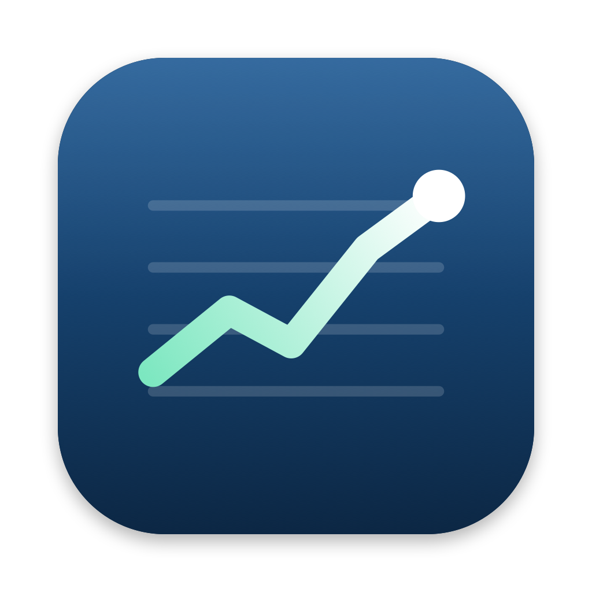
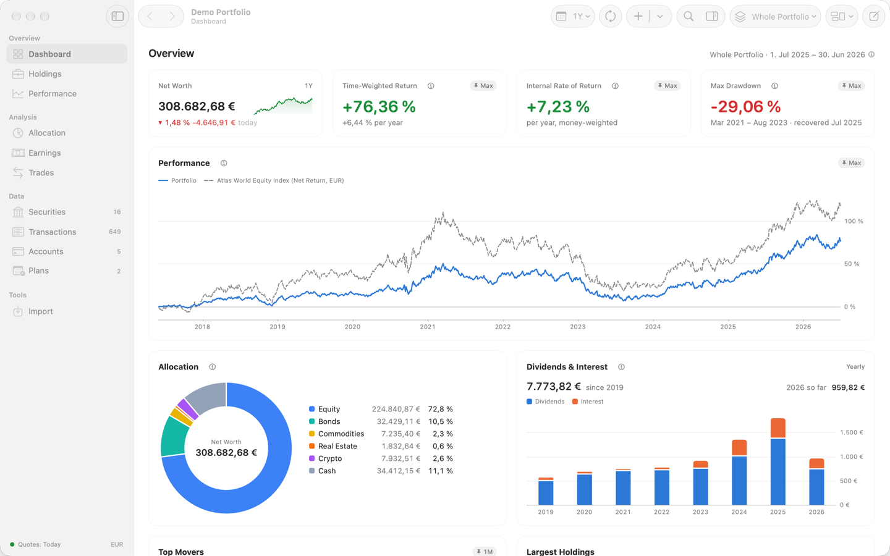
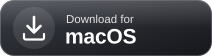
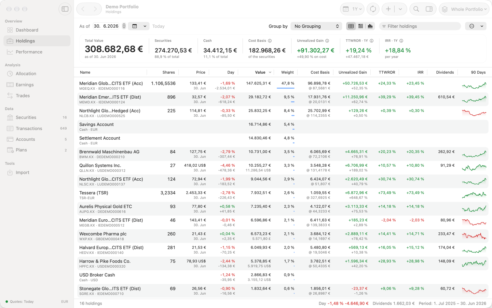
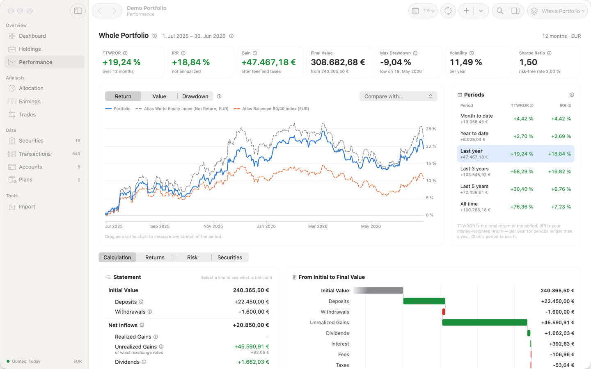
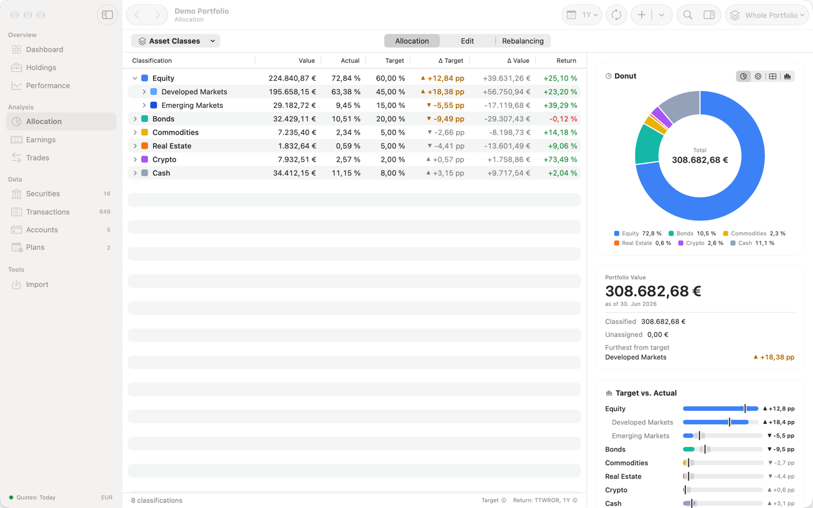
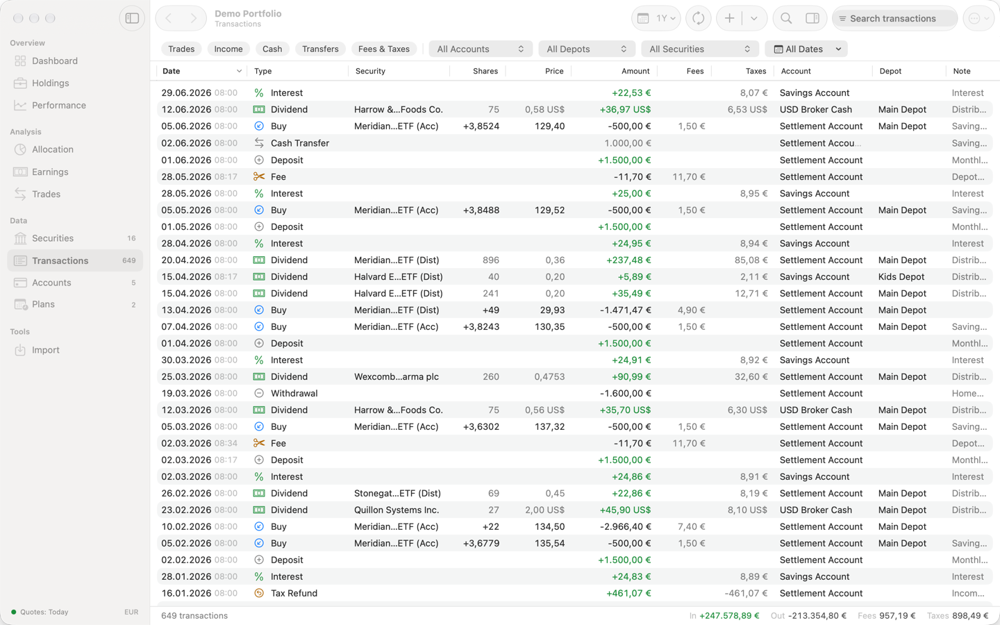

# Kontor



Kontor is a native macOS portfolio tracker: securities, cash accounts and honest performance
measurement in one fast, calm, keyboard-friendly app. Documents are plain JSON (`.kontor`), so your
data stays portable, diff-able and yours.

Kontor is an original app. It can import files from other tools (Portfolio Performance XML, CSV) but
shares no code or design with them.

<picture>
  <source media="(prefers-color-scheme: dark)" srcset="docs/images/overview-dark.png">
  
</picture>

It is written in Swift for macOS 27, has no third-party dependencies, and keeps each portfolio in
one file you can copy, sync, back up or put under version control.

> **Preview.** Version 0.1.0 has passed its automated tests and a headless end-to-end self-test,
> but nobody has used it by hand yet. Keep a backup of anything you enter. See
> [Known limitations](#known-limitations).

## Install

<p>
  <a href="https://github.com/dwahdany/kontor/releases"></a>
</p>

Kontor needs macOS 27 or later.

| | Direct download | Build from source |
|---|---|---|
| **Updates** | Download the new release | `git pull` and rebuild |
| **Signature** | Developer ID, notarized | Ad hoc |
| **Sandboxed** | Yes | Yes (release build) |

### Direct download

1. Download `Kontor-<version>.zip` from the
   [Releases page](https://github.com/dwahdany/kontor/releases). Preview versions are marked
   *Pre-release*.
2. Unzip it and drag Kontor to Applications.
3. Open it and choose **Open Demo Portfolio** in the welcome window to look around, or start a
   new portfolio.

The app is signed with a Developer ID and notarized by Apple, so it opens without a Gatekeeper
warning. It is sandboxed: it reads and writes only the files you open or save, and connects to
the network only to download quotes and exchange rates.

### Build from source

You need Swift 6.4 (Xcode 27 or its Command Line Tools):

```sh
git clone https://github.com/dwahdany/kontor && cd kontor
Scripts/bundle.sh release
cp -R dist/Kontor.app /Applications/
```

[DEVELOPMENT.md](DEVELOPMENT.md) covers the build options, tests, the screenshot and self-test
modes, signing and releasing, and the architecture.

## Features

| Screen | What you get |
|---|---|
| **Dashboard** (⌘1) | A widget grid you arrange yourself (⌘E): net worth, returns, performance and value charts, allocation, top movers, largest holdings, dividends, drawdown, volatility, cash, upcoming plans, recent transactions, watchlist, consistency check — 21 widget kinds, several dashboards per file. A widget can be pinned to its own period and scope; Monthly Returns always shows whole years, statement widgets (net worth, holdings, cash) show the last day of the period, and Recent Transactions and Upcoming Plans always cover the whole portfolio. |
| **Holdings** (⌘2) | The statement of assets for any day: sortable, groupable table (depot, currency, any taxonomy) with cost basis, unrealized gain, TTWROR, IRR, dividends and sparkline; treemap and concentration views; inspector with price chart and open tax lots; buy / sell / dividend straight from a row. |
| **Performance** (⌘3) | TTWROR, IRR, gain, drawdown, volatility and Sharpe ratio for the period; return vs. benchmarks, value vs. invested capital, drawdown; drag across the chart to measure any stretch; a reconciling statement from initial to final value with the transactions behind every line; monthly heatmap, calendar years, rolling returns, risk figures, performance per security. |
| **Allocation** (⌘4) | Taxonomies (asset classes, regions, sectors … or your own) with target weights; donut, sunburst, treemap and target-vs-actual; an editor with drag-and-drop assignment and weighted splits; rebalancing proposals that become reviewed, undoable transactions. |
| **Earnings** (⌘5) | Dividends, interest, fees and taxes per month, quarter and year; year × month matrix; per security and per account; payment list; a 12-month dividend calendar with an estimate for the year ahead. |
| **Trades** (⌘6) | Closed and open trades with holding period, gain, return and return per year; win rate, profit factor, distributions; realized results per calendar year for your tax records. |
| **Securities** (⌘7) | Master data, watchlists, price chart with moving averages, purchase price and comparison; transactions, price history, events (stock splits), data source (Yahoo Finance, CoinGecko, manual) and notes per security. |
| **Transactions** (⌘8) | The complete ledger with filters, running balance per account and consistency issues; one editor for all 15 transaction kinds that calculates the missing figure, converts currencies and previews the resulting position. |
| **Accounts** (⌘9) | Cash accounts and depots: balances, net worth by account, statements, positions per depot. |
| **Plans** (⌘0) | Savings, deposit and withdrawal plans: due executions are proposed for review, never booked silently; per-plan performance; a what-if projection. |
| **Import** | Portfolio Performance files (become the content of a new portfolio, merge into an existing one, or open as a portfolio of their own), CSV wizard for broker statements, quotes and security lists with a live preview and remembered layouts; export as CSV, Portfolio Performance XML or Kontor JSON. Drop a file anywhere on a screen to import it. |

<picture>
  <source media="(prefers-color-scheme: dark)" srcset="docs/images/holdings-dark.png">
  
</picture>

<picture>
  <source media="(prefers-color-scheme: dark)" srcset="docs/images/performance-dark.png">
  
</picture>

<picture>
  <source media="(prefers-color-scheme: dark)" srcset="docs/images/allocation-dark.png">
  
</picture>

<picture>
  <source media="(prefers-color-scheme: dark)" srcset="docs/images/transactions-dark.png">
  
</picture>

Everywhere: one reporting period and one scope (whole portfolio, a depot, an account, a
classification) per window; ⌘K command palette; inspector (⌥⌘I); every change is one undo step;
ⓘ popovers explain the finance terms; light and dark; numbers in your region's format.

**Words Kontor uses.** A **depot** is a securities account (where shares and funds are held); a
**cash account** holds money in one currency; a depot settles against its **reference account**.
Ledger entries are always called **transactions**. **TTWROR** is the time-weighted return, **IRR**
the money-weighted return. Both are shown **per year** only when there is more than a year to
measure — a portfolio that is four weeks old shows the return of those four weeks, whatever period

## Moving from Portfolio Performance

Open **Import** and choose your Portfolio Performance file, or drop it on the window. Use the XML
format; for password-protected or binary files choose *File › Save As › XML* in Portfolio
Performance first. CSV exports go through the CSV wizard.

**How numbers differ from Portfolio Performance.** Imported ledgers reproduce PP's balances, share
counts and trades. Two conventions differ on purpose: the cost basis includes purchase fees but
**not** purchase taxes (PP includes both), and exchange rates are not part of PP files — Kontor
downloads them right after an import, and until then amounts in foreign currencies count as zero
(the import sheet says so).

## Your data

- **One file per portfolio.** A `.kontor` document is plain JSON. Nothing is stored anywhere else.
- **Network.** Kontor contacts the quote sources you configure per security (Yahoo Finance,
  CoinGecko) and the European Central Bank for exchange rates. Nothing about your portfolio is
  uploaded.
- **Export.** CSV, Portfolio Performance XML or Kontor JSON, at any time.

## Known limitations

Verified by the self-test, the test suites and screenshots; **never driven by hand** — nothing that
needs a pointer, a key press or a system panel has been exercised.

- **Not exercised:** drag and drop, keyboard shortcuts and focus order, context menus, open/save
  panels (sandboxed or not), Finder double-click, Versions browser, VoiceOver and Full Keyboard
  Access. Heatmap, treemap, waterfall, donut and sunburst selection is pointer-only.
- **Documents:** unknown top-level keys of a file are dropped on the next save. Undo steps are whole
  snapshots (bounded in number, not in bytes). Undo and Redo stay enabled while an editor sheet is
  open. Reverting in the very instant a file is replaced on disk has been seen to fail with "not in
  the correct format"; a moment later it works.
- **Numbers:** the cost basis excludes purchase taxes (Portfolio Performance includes them). A
  security's annualized TTWROR is annualized over the whole period even if it was held for part of
  it. Very short trades show an astronomically large annualized return. A classification scope and
  the same group in a taxonomy can differ by cents (two apportioning rules). Same-day entries
  without a time of day are ordered by id, except where that would produce a short position.
- **Import:** no PDF import. Quote CSV files hold one security. Exchange rates are not read from
  Portfolio Performance files (they are downloaded afterwards). Portfolio Performance attributes of
  accounts, depots and plans, `latestFeed` settings, a plan's "generate automatically" switch and
  client properties are dropped without a note. The CSV transactions export has no column for a
  security's currency or a dividend's ex-date. The import report cannot be reopened after importing.
- **Plans:** pausing a plan overwrites its end date (the model has no pause state). The stress
  sample has no plans.
- **Screens:** names in dense tables are truncated in the middle (full name in the tooltip); at
  900 pt width the Securities detail header and the Transactions table are cut off rather than
  reflowed; a total row scrolls with its table. A flat chart series gets a wide default axis. The
  Dashboard does not flag outdated quotes beyond the sidebar footer. There is no place to enter an
  exchange rate by hand.
- **Wording:** a pass over vocabulary (one gain figure has several names across screens, portfolio
  share is called Weight, Share and Actual) and a shared section-tab, filter-field and inspector
  layout is still to do. Strings are not localisable yet (English only; numbers and dates follow
  the region).
